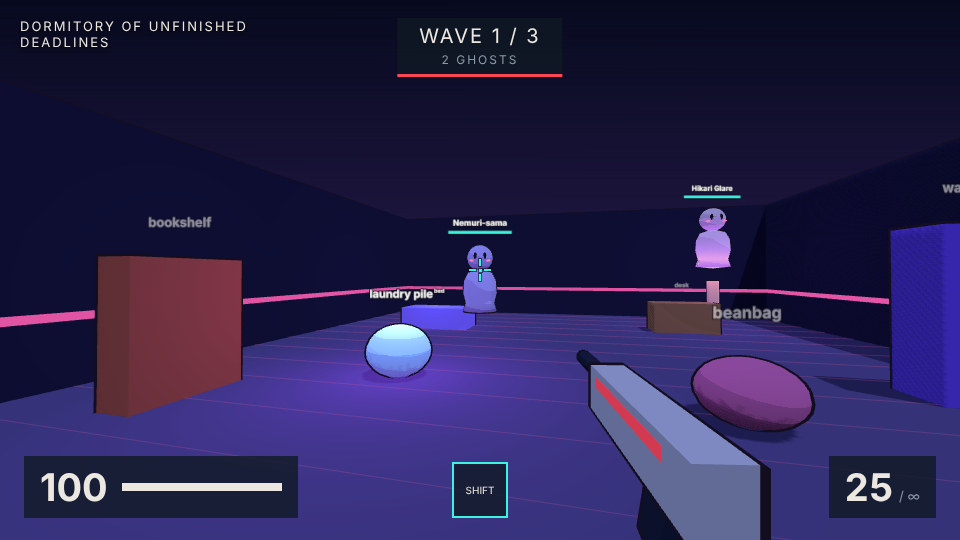

# PHANTOM FUSION

**Your room. Their haunt.** Take a photo of any real room. Gemma 4 looks at it, rebuilds it as a 3D arena, and hides anime ghosts inside the real objects it spotted. Then you fight them in a fast, cel-shaded shooter inspired by Valorant.

Built at Hacktoberfest Southampton 2026 for the theme **Fusion**: the real world fused with an AI-generated game world.



- Runs **fully offline** once downloaded. Gemma 4 runs locally in Ollama, nothing leaves your machine.
- Open source (Apache-2.0), built on the open-weight **Gemma 4** model.

## How it works

```
 photo ──► game server (:8081) ──► Gemma 4 in Ollama (:11434) ──► level JSON
                │                          ▲
                ▼                          │
        Three.js shooter            Open WebUI (:3000)
   (haunted objects spawn ghosts)   chat with the same Gemma API
```

1. **Gemma 4 vision** reads the photo: room type, colours, lighting and objects.
2. It returns a **level JSON**: arena size, palette, object positions and sizes, and 2 to 5 *haunted* objects, each with a named ghost and a personality.
3. The **game** builds the arena from that JSON. During each wave a haunted object shakes, glows and a ghost bursts out of it.
4. **Open WebUI** talks to the same Gemma API, so you can also upload photos in a chat, tweak the arena by talking, and paste the JSON into the game.

Three separate containers: `ollama` (the Gemma brain, exposed as an API), `open-webui` (chat UI) and `game`.

## Quick start (Docker)

You need Docker Desktop and about 15 GB of free disk.

```bash
git clone https://github.com/dunja-g/Hack_ECSS.git
cd Hack_ECSS
cp .env.example .env
docker compose up -d --build
docker compose exec ollama sh /setup/setup-model.sh   # downloads Gemma 4 once (~6 GB)
```

Open:
- Game: http://localhost:8081
- Open WebUI: http://localhost:3000 (pick the **phantom-architect** model)

No internet? Click **Student dorm** or **B60 lab** in the game to play a pre-built level.

### Faster on a Mac (Gemma on the GPU)

Docker on macOS cannot use the Apple GPU, so Gemma runs on the CPU inside Docker. For a big speed-up, run Ollama as the Mac app instead:

1. Install the Ollama app from ollama.com and open it.
2. In `.env` set `OLLAMA_URL=http://host.docker.internal:11434`
3. Run:
   ```bash
   sh ollama/setup-model.sh
   docker compose up -d --build open-webui game
   ```

### Without Docker

```bash
ollama pull gemma4:e4b-it-qat
python3 server/server.py        # Python 3.10+, no packages needed
```

## Controls

| Key | Action |
|---|---|
| WASD | Move |
| Mouse | Aim |
| Left click (hold) | Shoot |
| Right click (hold) | Aim down sights: zoom in, tighter spread, slower movement |
| R | Reload |
| Shift | Dash (3 s cooldown) |
| Space | Jump (you can stand on furniture) |

Headshots do 2.5x damage. Ghosts sway side to side, so aim for the head. Three waves; the last one has a boss.

Slow laptop? Open http://localhost:8081/?lowfx

## Choosing a Gemma 4 model

Set `GEMMA_MODEL` in `.env`, then run the setup script again.

| Model | Download | Notes |
|---|---|---|
| `gemma4:e2b-it-qat` | 4.3 GB | fastest, less accurate |
| `gemma4:e4b-it-qat` | 6.1 GB | **default**, good on a 16 GB laptop |
| `gemma4:12b-mlx` | 7.7 GB | best quality on a Mac, native Ollama only |

## Open WebUI extras (optional)

- **phantom-architect** model: created by the setup script. It already knows the level format, so upload a photo and it replies with level JSON. Copy it into the game under *Paste from Open WebUI*.
- **Play this room button**: `openwebui/play_room_action.py` adds a button under Gemma's reply that opens the level straight in the game. Install it in Open WebUI under *Admin Panel > Functions*.

## Project layout

```
docker-compose.yml        ollama + open-webui + game
.env.example              model and API settings
ollama/setup-model.sh     pulls Gemma 4, creates the phantom-architect preset
server/server.py          game server + /api/analyze (photo -> Gemma -> level)
server/prompt.txt         the level-design prompt Gemma follows
game/                     Three.js shooter (Three.js bundled for offline use)
game/samples/             pre-built levels
openwebui/                optional Open WebUI action
scripts/mock_ollama.py    fake Gemma for testing without the model
```

## Testing without Gemma

```bash
python3 scripts/mock_ollama.py &
python3 server/server.py
```

## Team

Built by Dunja Gvozdenovic and [Jjho0](https://github.com/Jjho0) at Hacktoberfest Southampton 2026.

## License

Apache-2.0. Three.js is MIT licensed (see `game/vendor/THREE_LICENSE.txt`). Gemma 4 is released by Google under Apache-2.0.
